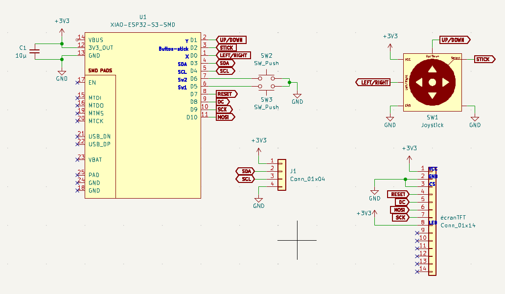

# 2026-11-24 : Début du schéma électronique sous KiCad

**Séance :** planifiée · **Durée :** à compléter

## Fait

### Préparation de KiCad

Importation de la bibliothèque de composants du MakerSpace dans KiCad.

### Début du schéma

Je pars de l'ESP32, puis j'y connecte :

- l'écran TFT ST7789 ;
- le joystick.

## Pourquoi

La bibliothèque du MakerSpace contient les composants (et leurs empreintes)
disponibles sur place : le schéma correspond directement au matériel qu'on
utilise.

## Reste à faire

- Compléter le schéma avec les autres composants.
