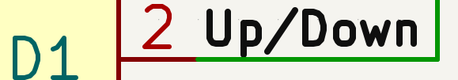
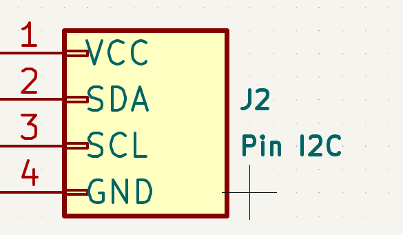

# 2026-11-26 : Corrections du schéma KiCad

**Séance :** planifiée · **Durée :** à compléter

## Fait

### Première relecture du schéma avec Alban

Le schéma est correct, mais plusieurs points sont à améliorer.

#### Labels locaux plutôt que boîtes de texte

Sur les ports, il faut éviter les boîtes de texte et préférer des **labels locaux**.

#### Noms des lignes dans les symboles

J'ai modifié les symboles pour y ajouter les noms des lignes et des bus.

### Réponses aux questions sur le schéma

**1. La broche D6 est aussi la sortie TX de l'UART0 : la puce y émet des
messages au démarrage. Que se passe-t-il si SW2 la relie directement à GND
pendant ce temps, et comment l'éviter ?** *(concept GPIO & monde numérique)*

Au démarrage, l'ESP32 émet un message de boot sur D6 (UART0) : la broche
alterne entre HIGH et LOW. Si SW2 la relie directement à GND, on court-circuite
cette sortie. Pour l'éviter, on ajoute une **résistance de 1 kΩ** en série.

**2. Les boutons n'ont pas besoin de résistance de tirage externe : pourquoi ?**
*(tutoriel Les modules de la mallette)*

On peut utiliser la **résistance de pull-up interne** de l'ESP32.

**3. Le bus I2C a besoin de résistances de tirage : où, et de quelle valeur ?**
*(concept Les bus de communication)*

Deux **résistances de 4,7 kΩ**, qui relient respectivement SDA et SCL au VCC.

**4. La LED témoin : quelle résistance pour un courant de quelques mA sous
3,3 V ?** *(calculateur du concept GPIO)*

Pour une LED rouge, une **résistance de 330 Ω**.

**5. Le découplage : quels condensateurs, et où les placer pour qu'ils soient
utiles ?**

Un **condensateur de 100 nF** et un de **10 µF**, placés en parallèle entre VCC
et GND, au plus près de la puce.

**6. Le joystick est alimenté en 3V3, jamais en 5 V : pourquoi ?**
*(concept ADC & PWM)*

Un joystick, c'est 2 signaux analogiques (lus par l'ADC) et 1 bouton (GPIO).
L'ADC de l'ESP32 fonctionne en 3,3 V : lui envoyer un signal supérieur risque
de griller l'ESP32.

## Pourquoi

Les corrections du schéma ont été demandées par Alban lors de la relecture.
Les réponses aux questions justifient le choix des composants ajoutés autour
de l'ESP32 (résistances, condensateurs, alimentation du joystick).

## Reste à faire

- Ajouter au schéma les composants issus des réponses : résistance de 1 kΩ
  sur D6, pull-up I2C de 4,7 kΩ, résistance de 330 Ω pour la LED,
  condensateurs de découplage.
